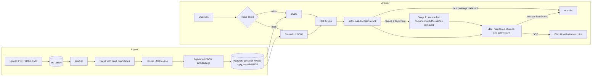

# LexIQ

Eval-driven RAG platform for document QA: hybrid retrieval (BM25 + pgvector HNSW),
cross-encoder rerank, citation-grounded streaming answers, and an abstain path when
evidence is insufficient. Every retrieval and prompt change is scored against a
500-question, lawyer-annotated golden set in CI.

| | |
|---|---|
| Corpus | **52,650 pages** (561 documents, 124,353 chunks): all 510 CUAD contracts + 51 volumes of federal regulations |
| Retrieval quality | recall@5 **0.762** within a contract; **0.729** across all 52k pages with two-stage retrieval (up from 0.338) ([details](#whole-corpus-quality)) |
| Retrieval latency | **179 / 188 ms** p50 / p95 per request at 52k pages; <1 ms on a cache hit |
| CI | lint, 82 tests, web build, and a golden-set gate that fails on regression |

See [docs/PLAN.md](docs/PLAN.md) for the build plan and [evals/](evals/README.md) for the eval
methodology.

## How it works



- **Ingestion** keeps real page boundaries (PDF pages, HTML print breaks) so citations point
  at pages, strips running headers and footers, and chunks by embedder tokens with overlap.
- **Retrieval** runs BM25 and dense search in parallel, fuses them with Reciprocal Rank
  Fusion, and reranks the top 10 with a local int8 cross-encoder: no per-query API cost.
- **Generation** gives the model numbered passages and requires a `[n]` citation on every
  factual sentence; citations are validated afterwards. Answers stream over server-sent events.
  Claude or an OpenAI model, whichever key is set (`LLM_PROVIDER` picks when both are).
- **Two-stage retrieval** handles corpus-wide questions that name a document ("In the Supply
  Agreement between Acme and Globex, ..."): stage 1 finds the document, stage 2 searches it
  with the identifying words removed, so the preamble that repeats the names doesn't crowd out
  the clause. Questions that name no document stay corpus-wide.
- **Abstaining** happens before the model when nothing relevant is retrieved, and when the
  model reports the passages don't answer the question.
- **Caching** keys reranked retrievals and finished answers by a corpus version that every
  ingest bumps, so cached results never outlive the documents they came from.

## Stack

- `apps/web` — Next.js 16 (App Router, Tailwind)
- `services/api` — FastAPI, SQLAlchemy (async), Alembic, arq, ONNX Runtime, Python 3.12 via uv
- `infra` — ParadeDB Postgres 17 (pgvector + pg_search BM25), Redis

## Run locally

Requires Docker, [uv](https://docs.astral.sh/uv/), pnpm, and an `ANTHROPIC_API_KEY` or
`OPENAI_API_KEY` in `.env` for answers (search works without one).

```bash
make setup         # .env, deps, ONNX models, containers, migrations
make api           # http://localhost:8000/health
make worker        # ingestion jobs
make web           # http://localhost:3000
make test
make eval-corpus   # once: fetch CUAD, ingest the 98 eval contracts
make eval          # golden-set retrieval metrics + regression gate
make bench         # per-request latency, cold then warm cache
```

To load the full 52k-page corpus (about 45 minutes on an M5 Pro, with `make worker` running):

```bash
make corpus-cuad   # all 510 CUAD contracts
make corpus-cfr    # fetch 51 CFR volumes from govinfo.gov, then ingest them
```

Upload a document and watch it move `pending → processing → ready`:

```bash
curl -F file=@contract.pdf localhost:8000/documents
curl localhost:8000/documents
```

Search (reranked passages with pages, per-stage timings, and an abstain flag):

```bash
curl localhost:8000/search -H 'content-type: application/json' \
  -d '{"query": "How old must a senator be?", "top_k": 3}'
```

Ask (server-sent events: `sources`, `delta`…, then `done` with citations, abstain/refusal
flags, token usage and timings):

```bash
curl -N localhost:8000/answer -H 'content-type: application/json' \
  -d '{"query": "How old must a senator be?"}'
```

Tests use a separate `lexiq_test` database and Redis DB 15. Tests that call the real API
are skipped unless `LEXIQ_LIVE_TESTS=1`. Postgres listens on `5433` and Redis on `6380` so
they don't clash with local installs.

## Performance

Retrieval latency per request (100 golden questions run one at a time on an Apple M5 Pro,
`make bench`) and recall on the 500-question golden set (`make eval`).

| Configuration | Index | p50 | p95 | recall@5 | recall@1 |
|---|---|---|---|---|---|
| Rerank 30 candidates, fp32 | 98 contracts | 387 ms | 516 ms | 0.765 | 0.452 |
| Rerank 10 candidates | 98 contracts | 186 ms | 198 ms | 0.762 | 0.457 |
| + int8 reranker | 98 contracts | 159 ms | 169 ms | 0.762 | 0.459 |
| **Same, contract-scoped** | **52,650 pages** | **179 ms** | **188 ms** | **0.762** | **0.459** |
| Same, whole corpus, single stage | 52,650 pages | 173 ms | 180 ms | 0.338 | 0.045 |
| **Whole corpus, two-stage (default)** | **52,650 pages** | **349 ms** | **363 ms** | **0.729** | **0.433** |
| Repeat question (Redis cache hit) | either | <1 ms | 1 ms | — | — |

What the sweeps showed:

- Reranking 10 candidates instead of 30 costs 0.003 recall@5. The cross-encoder rarely lifts
  a candidate from below RRF's top 10 into the top 8.
- Truncating reranker input from 512 to 256 tokens would have cut latency further but dropped
  recall@5 to ~0.70: many clauses sit past a chunk's first 256 tokens. Kept at 512.
- Dynamic int8 quantization of the cross-encoder (87 MB → 22 MB) leaves recall unchanged.
- Growing the index 40× (3k → 124k chunks) didn't move recall: pgvector's iterative filtered
  HNSW scan still finds a contract's clauses when it is 0.03% of the index. BM25 is the stage
  that grew (40 → 66 ms) and is now the main non-rerank cost.
- At the start of evals, the retrieval-stage abstain threshold refused 33% of answerable
  questions; it's now a floor for off-topic queries (1.4% false refusals) and the model's
  insufficient-evidence path does the real abstaining.

### Whole-corpus quality

The golden questions say "this agreement", so they're evaluated within their contract. To
measure search across all 52k pages, `evals/golden_corpus.jsonl` rewrites the 420 answerable
questions whose contract has an identifiable party to name it, from CUAD's own annotations
("In the Master Supply Agreement between Reynolds Consumer Products LLC and Pactiv LLC, ...").
A hit only counts if the clause comes from the named contract.

| | Within the contract | Whole corpus |
|---|---|---|
| Right contract, top 1 / top 5 | — | **0.964 / 1.000** |
| Right clause recall@1 | 0.459 | 0.045 |
| Right clause recall@5 | 0.762 | 0.338 |
| Right clause recall@8 | 0.831 | 0.431 |

Single-stage retrieval found the contract almost every time but returned the wrong passage:
on 35 of 49 sampled misses the top result was the contract's preamble, the one chunk that
repeats the party names the question uses. Two-stage retrieval fixes this. Stage 1 picks the
document (the top reranked chunk's document); stage 2 searches inside it with the identifying
words removed: capitalized query words that also appear in the document's opening chunks.

| Whole corpus | Single stage | Two-stage | Ceiling (original unnamed question in stage 2) |
|---|---|---|---|
| Clause recall@1 | 0.045 | **0.433** | — |
| Clause recall@5 | 0.338 | **0.729** | 0.731 |
| MRR@10 | 0.159 | **0.556** | — |
| Routed / to the named contract | — | 100% / 96.4% | — |

The number of words removed is also the gate: a question that names nothing in the document
isn't narrowed to it. Asked across the corpus, the 500 unnamed golden questions were routed
0% of the time, and contract-scoped results are unchanged. The costs: a second retrieval pass
(whole-corpus p50 173 → 349 ms), and when stage 1 picks the wrong contract (3.6%) the right one
isn't in the results at all. Routing on fusion scores alone would save ~110 ms for ~3 points of
routing accuracy.

Index size at 52k pages: 341 MB of chunk rows, 237 MB HNSW index, 84 MB BM25 index.

Anthropic prompt caching isn't used: the system prompt is below the minimum cacheable length
and the sources differ per question.

### Answers

End to end with `gpt-4.1-mini` writing the answer: 100 golden questions run one at a time
against the 52,650-page index, contract-scoped (`make bench` with `--answers`).

| Stage | p50 | p95 |
|---|---|---|
| Retrieval | 216 ms | 227 ms |
| First answer token | 902 ms | 1,118 ms |
| Complete answer | 1,404 ms | 2,366 ms |

**$0.0016 per query** at OpenAI's standard pricing (mean 3,652 input and 98 output tokens);
retrieval and reranking run locally and add nothing.

Judged on the first 100 golden questions (81 answerable, 19 unanswerable), with
`gpt-4.1-mini` also as the judge:

| Metric | Value |
|---|---|
| Faithfulness: every claim supported by the given sources | 0.974 |
| Answer correctness: agrees with CUAD's lawyer-marked evidence | 0.852 |
| Citations valid (no out-of-range `[n]`) | 1.000 |
| Sentences carrying a citation | 0.50 |
| Unanswerable questions correctly declined | 0.684 (13 of 19) |
| Declines that were right to decline | 0.565 (13 of 23) |

A model grading its own answers can be lenient, so faithfulness is best read as an upper
bound. Abstaining is the weak spot: the model declined 10 answerable questions and answered 6
that CUAD marks as having no such clause. The run cost $0.29 ($0.16 answers, $0.13 judging).
These are the answer baselines in `evals/baseline.json`; CI gates on them only when a key is
configured, and doesn't have one.

## Data

- **[CUAD v1](https://www.atticusprojectai.org/cuad)** — 510 commercial contracts with lawyer
  annotations, © The Atticus Project, [CC BY 4.0](https://creativecommons.org/licenses/by/4.0/).
  Used for the golden set and the contract corpus.
- **Code of Federal Regulations, 2025 edition** — Titles 12, 15, 16, 17, 26, 29 and 31 from
  [govinfo.gov](https://www.govinfo.gov/app/collection/cfr), US government works in the public
  domain. [corpora/cfr-2025.json](corpora/cfr-2025.json) pins every volume's URL, SHA-256 and
  page count.
